## 本章流程：


## 1.非数值数据的编码
1. 西文字符-ASCII

2. Unicode字符集
它为世界上几乎所有的字符都规定了一个唯一的数字编号，这个编号我们称为码点 (Code Point)。   
没有规定码点在计算机中如何存储。 

3. UTF-8
UTF-8 最大的一个特点，就是它是一种变长的编码方式  
它使用 1~4 个字节表示一个符号，根据不同的符号而变化字节长度

4. GBK编码
GBK 采用双字节编码方案。对于简体中文汉字，通常使用两个字节来表示一个汉字。   
对于 ASCII 字符（英文字符、数字、常见符号等），GBK 采用单字节编码，其编码范围与 ASCII 编码相同，即 0x00 到 0x7F

## 2.无符号整数的编码

## 3.有符号整数的编码
1. 原码编码  


原码（0不唯一）

## 4.原码、真值、补码之间的转换


### 移码
$[x]_{移} = 2^{n-1} + x \quad\quad x 是真值，n 是 x 原码的位数，也是移码的位数$


## 5.有符号数和无符号数之间的转换

### 有符号整数转换为无符号整数
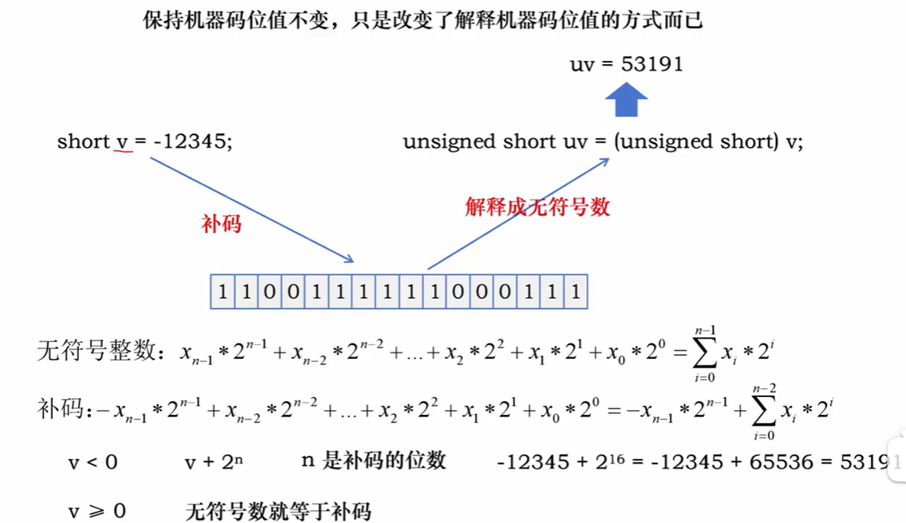

### 无符号整数转换为有符号整数
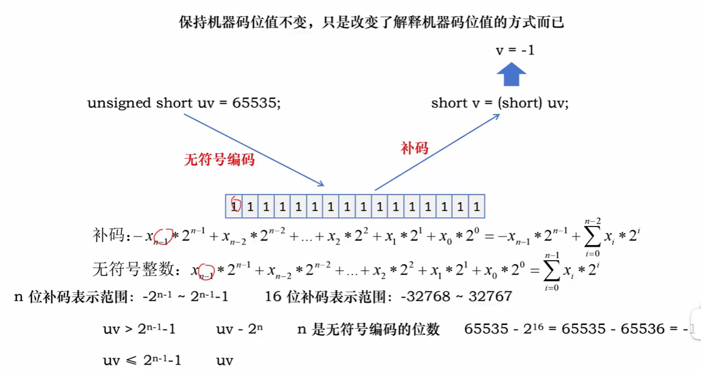

> 此处可直接凭理解，不需要严格推理

## 6.零扩展，符号扩展和位截断
1. 零扩展
无符号数，前面直接添零
2. 符号扩展
有符号数，正数前添1，负数前添零
> 有符号数扩展为无符号数：先符号扩展，再直接解释为无符号数。
3. 位截断
直接丢弃高位部分，只保留低位部分    
位截断可能会改变数

## 7.定点小数表示法

### 二进制转换为十进制

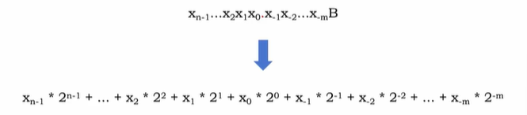

### 十进制转换为二进制:    

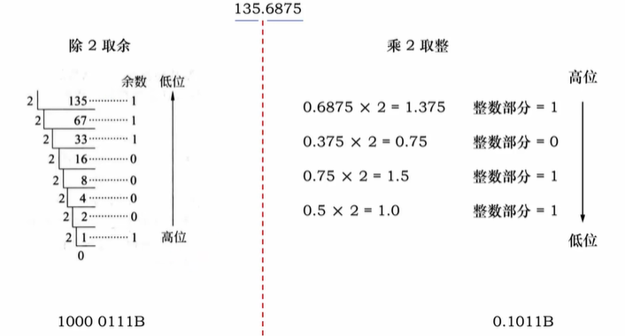

不是所有都可以转换

## 8.浮点数编码

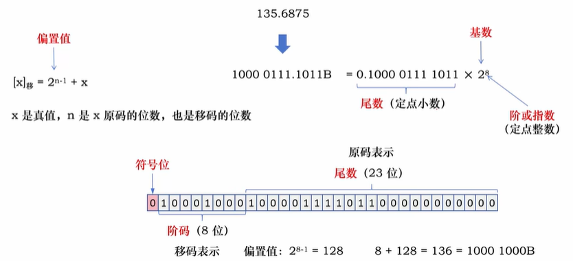

### 规格化
尾数的最高位为 “1”  
-|左规 小数点右移  
-|右规 小数点左移   

## 9.浮点数编码标准

### IEEE 754浮点数标准
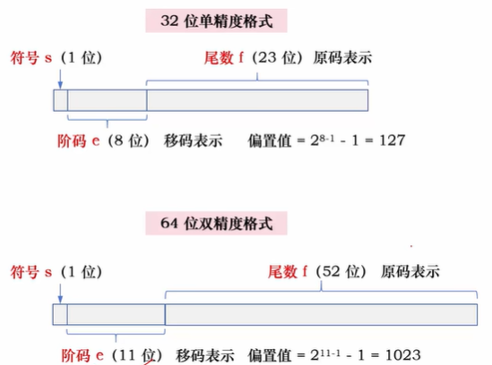

IEEE 754 规定尾数小数点前一位总是 1（隐藏位）。

|          | 32 位单精度格式 | | | | 64 位双精度格式 | | | | |
|:---------| :---: | :---: | :---: | :---: | :---: | :---: | :---: | :---: | :---: |
| **值的类型** | **符号 s** | **阶码 e** | **尾数 f** | **值** | **符号 s** | **阶码 e** | **尾数 f** | **值** | |
| 正零       | 0 | 0 | 0 | +0 | 0 | 0 | 0 | +0 | |
| 负零       | 1 | 0 | 0 | -0 | 1 | 0 | 0 | -0 | |
| 正无穷大     | 0 | 255 (全 1) | 0 | $+\infty$ | 0 | 2047 (全 1) | 0 | $+\infty$ | |
| 负无穷大     | 1 | 255 (全 1) | 0 | $-\infty$ | 1 | 2047 (全 1) | 0 | $-\infty$ | |
| 无定义数     | 0 或 1 | 255 (全 1) | $\neq 0$ | NaN | 0 或 1 | 2047 (全 1) | $\neq 0$ | NaN | |
| 规格化非零正数  | 0 | $0 < e < 255$ | f | $1.f \times 2^{e-127}$ | 0 | $0 < e < 2047$ | f | $1.f \times 2^{e-1023}$ | |
| 规格化非零负数  | 1 | $0 < e < 255$ | f | $-1.f \times 2^{e-127}$ | 1 | $0 < e < 2047$ | f | $-1.f \times 2^{e-1023}$ | |
| 非规格化正数     | 0          | 0                | f ≠ 0    | 0.f × 2<sup>-126</sup>  | 0          | 0                  | f ≠ 0    | 0.f × 2<sup>-1022</sup>  |
| 非规格化负数     | 1          | 0                | f ≠ 0    | -0.f × 2<sup>-126</sup> | 1          | 0                  | f ≠ 0    | -0.f × 2<sup>-1022</sup> |

<br>
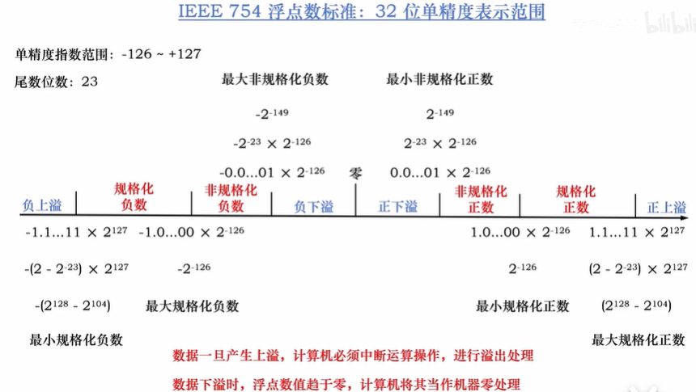

> 64位双精度与之类似

int->float 不会发生溢出，但可能有数据被舍弃。float的精度没有int高。
int/float->double，不会溢出，数据不会被丢弃。

## 10.数据的存储

### 字节存储
1. 大端序
将数据最高有效字节存放在低地址单元中，将最低有效字节存放在高地址单元中
2. 小端序
将数据最高有效字节存放在高地址单元中，将最低有效字节存放在低地址单元中


### 内存对齐

1. 4的倍数   
从硬件角度看：数据线的 32 根线路直接将内存中连续的 32 位（4 字节）数据位对位地传输到 CPU 内部的寄存器等部件中，不需要额外的处理
2. 非4的倍数    
如果要读取的数据首地址不是 4 的倍数的话，就需要额外的出来来拼接或拆分数据。$即需要内存对齐$

#### 规则

规则一：每个成员存储的起始地址 % 该成员的长度 = 0      
规则二：结构体的长度也必须是最大成员长度的整数倍


## 11.数据运算

### 逻辑运算
1. 运算类型：$与、或、非、异或$

2. 逻辑移位：对无符号数进行移位  
左移时，高位移出，低位补 0   
右移时，低位移出，高位补 0
- 算术移位：
左移时，高位移出，低位补 0   
右移时，低位移出，高位补 符号  

### 算术运算

### 1.加法器
在讨论这两种加法器之前，首先要明确全加器的概念。全加器是实现1位二进制加法的基本单元，它有3个输入和2个输出：
- 输入：$A_i$、$B_i$（两个加数的第 $i$ 位）、$C_i$（来自低位的进位）
- 输出：$S_i$（本位和）、$C_{i+1}$（向高位的进位）

#### 1.串行进位加法器
串行进位加法器（Ripple Carry Adder, RCA）是将 $n$ 个全加器串联而成。低位的进位输出 $C_{i+1}$ 直接作为高位的进位输入 $C_{i+1}$。
#### 2.并行进位加法器
并行进位加法器（Carry Lookahead Adder, CLA），也称超前进位加法器，其核心思想是提前计算出所有进位，让所有位的进位几乎同时产生，从而消除进位传递的等待时间。

### 2.加减运算
有符号数

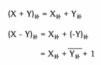

无符号整数相当于正整数  
正整数的补码表示就等于其二进制本身  
无符号整数的二进制表示相当于正整数的补码表示

### 3.带标志的加法器
- 零标志 ZF=1，结果为0  
- 符号标志 SF，最高位（有符号数才有意义）  
- 进位/借位标志 CF = C<sub>in</sub> ^ C<sub>out</sub> (无符号数有意义)   
- 溢出标志 OF = C<sub>n-1</sub> ^ C<sub>out</sub> （有符号数才有意义）  


### 4.符号数判断溢出方法

1. OF = C<sub>n-1</sub> ^ C<sub>out</sub>   
2. 相加数的符号不同，肯定不溢出；    
OF=$X_n Y_n \overline{F_n} + \overline{X_n}  \overline{Y_n} F_n$
3. 双符号位：$S_1S_2$:
- 00 正，无溢出
- 01 正，溢出
- 10 负，溢出
- 11 负，无溢出
#### OF=$S_1$ ^ $S_2$

> ^ 异或符号

### 5. 用标志判断数的大小
对$A-B$
1. 无符号数
```
if ZF=1
    A==B
else  
    if CF=0
        A>B
    else 
        B<A 
```
2. 有符号数
```
if ZF=1
    A==B
else  
    if OF=SF
        A>B
    else 
        B<A 

```
##  12.定点数乘除运算 

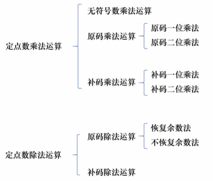

### 1.无符号数整数乘法
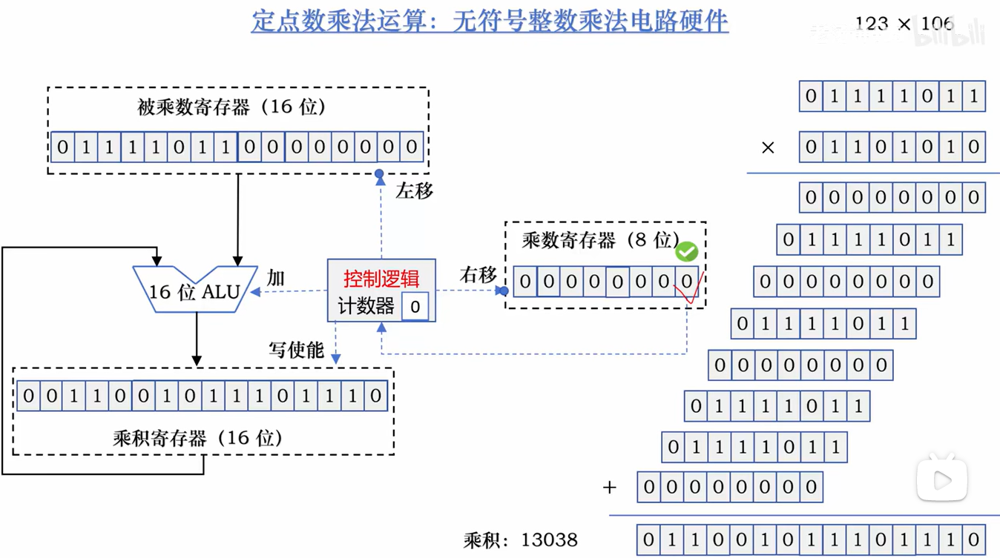

优化以上电路：   


### 2.原码乘法运算（有符号数）
#### 1.原码一位乘法

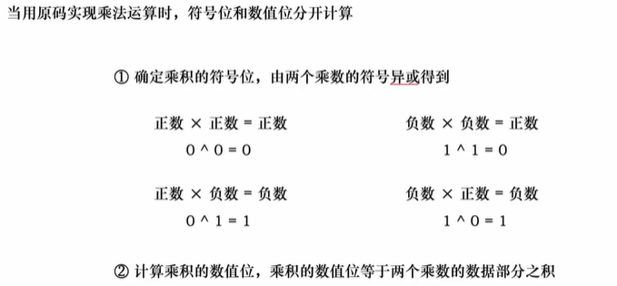

#### 2.原码两位乘法

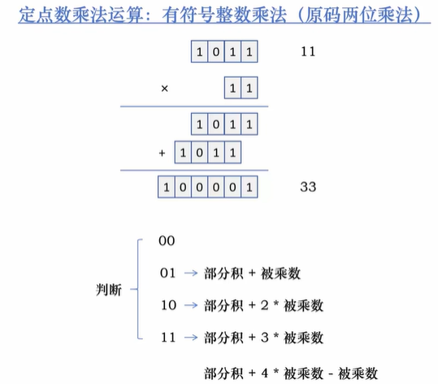
 
> 针对数值部分

### 3.补码乘法运算（有/无符号数）
#### 1.补码一位乘法

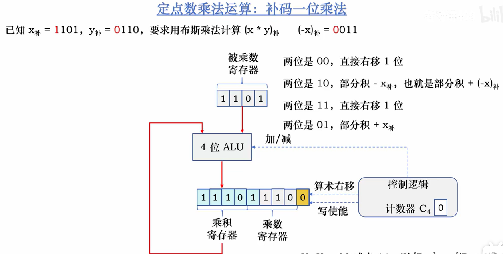
 
#### 2.补码两位位乘法
把乘数分成两位一组，根据两位二进制的组合决定加或减被乘数的倍数，形成的部分积每次右移两位


### 4.原码除法运算
#### 恢复余数除法
#### 不考虑符号
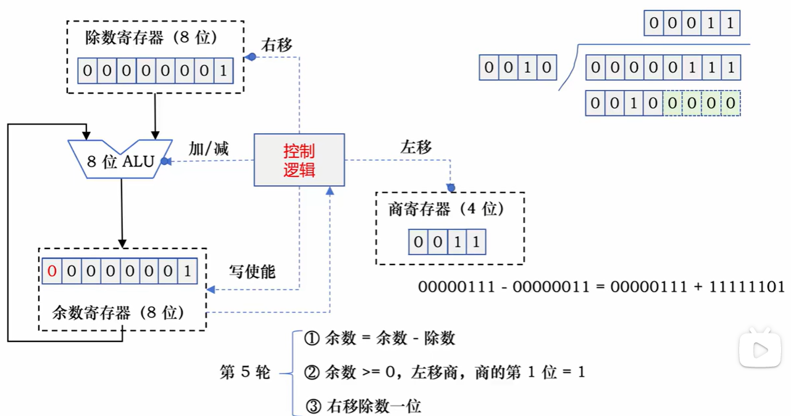
 
电路优化：  


#### 符号处理
如果两个除数符号相同，那么商的符号就是正数，如果两个除数符号不同，那么商的符号就是负数  
余数的符号和被除数的符号保持一致

#### 不恢复余数除法
最后一步可能需要恢复

-

### 5.补码除法运算
当中间余数与除数同号时，做减法；异号时，做加法  
若加减运算后，得到的新余数与原余数符号一致（即余数符号未变），则够减；否则不够减

#### 恢复余数除法

-

#### 不恢复余数除法

-
## 13.浮点数运算的尾数舍入策略

IEEE提供的4种尾数舍入策略
- 就近舍入到偶数：相当于十进制的 4 舍 5 入（不完全是），二进制的 0 舍 1 入  
当结果正好在两个可表示数中间时，根据就近舍入的原则无法操作，此时结果强迫为偶数

- 朝 +∞ 方向舍入：总是取数轴上右边的最近可表示数，也称为正向舍入或朝上舍入

- 朝 -∞ 方向舍入：总是取数轴上左边的最近可表示数，也称为负向舍入或朝下舍入

- 朝 0 方向舍入：直接截取所需位数，丢弃后面所有位，也称为截取、截断或恒舍法

### 浮点数加减运算

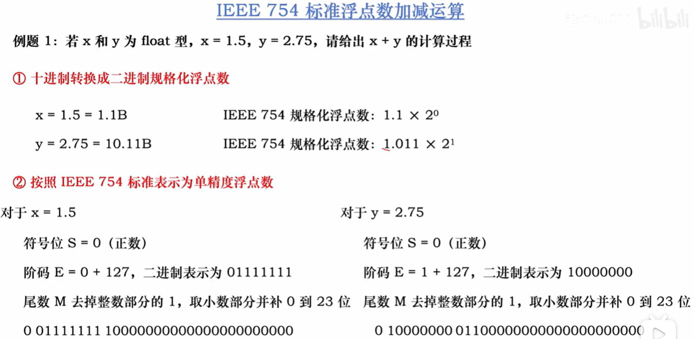

#### 溢出判断
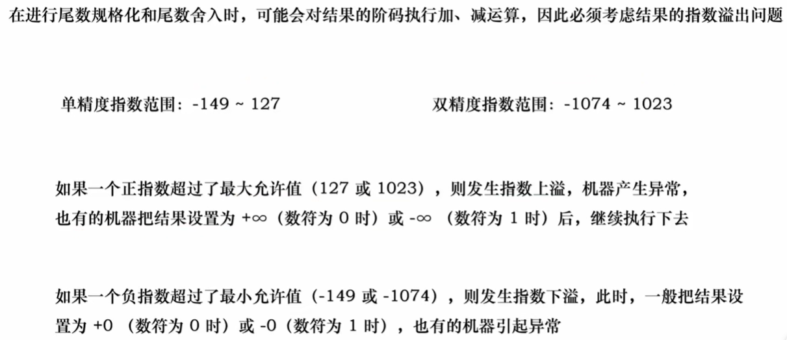
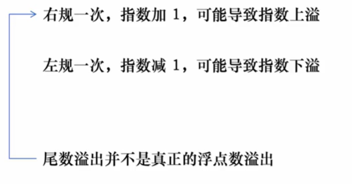


