### 总流程
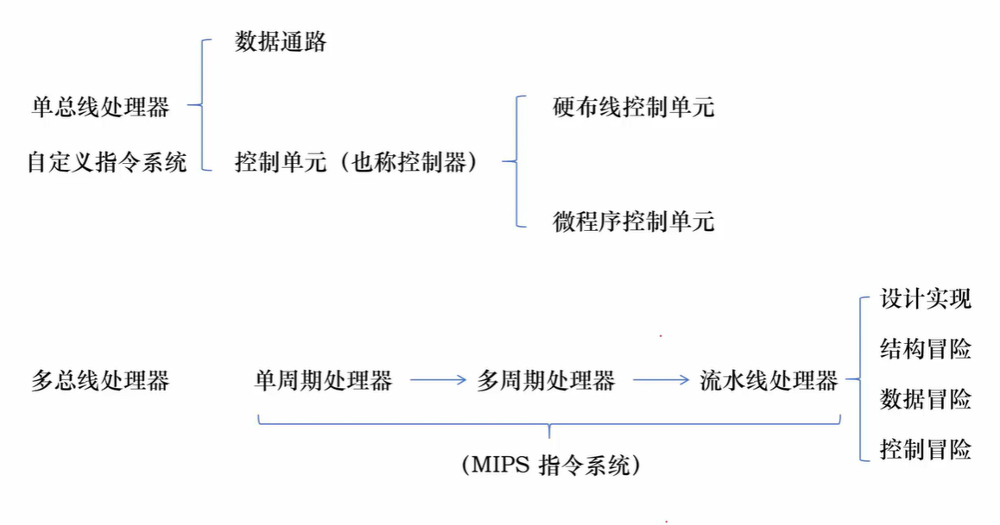

> 时序逻辑电路  
> 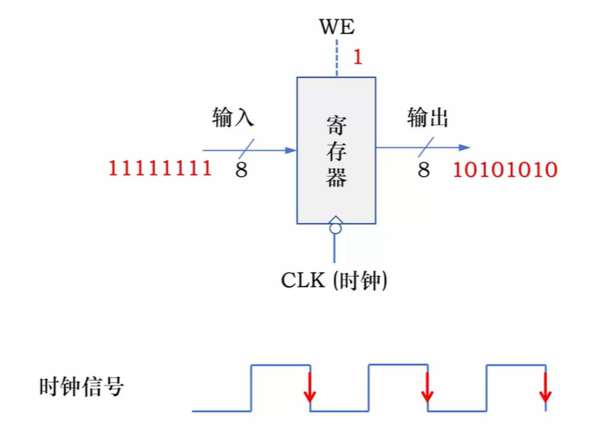 

## 1.数据通路和控制单元

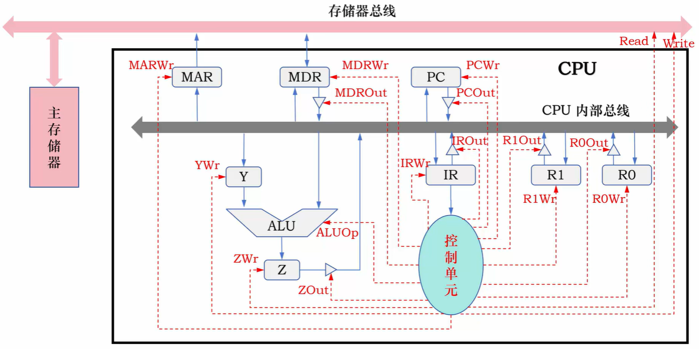 

数据通路：CPU 执行指令时，数据流动、传输、运算的硬件路径与部件集合（包含寄存器、ALU、总线、多路选择器、移位器等）。   
控制单元：控制单元根据每条指令功能的不同，生成对数据通路的控制信号，并正确控制指令的执行流程。

## 2.单总线CPU的指令取指阶段

① 有些微操作的次序不能改变，故安排微操作时钟周期时必须注意微操作的先后顺序   
② 凡是被控制对象不同的微操作，若能在一个时钟周期内执行，应尽量安排在同一个时钟周期内，以节省时间  
③ 如果有些微操作所占时间不长，应该将它们安排在一个时钟周期内完成，并且允许这些微操作有先后顺序  

如：   
T1: PC → MAR, 1 → Read  
T2: M[MAR] → MDR, PC + 1 → PC   
T3: MDR → IR, OP(IR) → CU  

## 3.单总线CPU的指令执行阶段

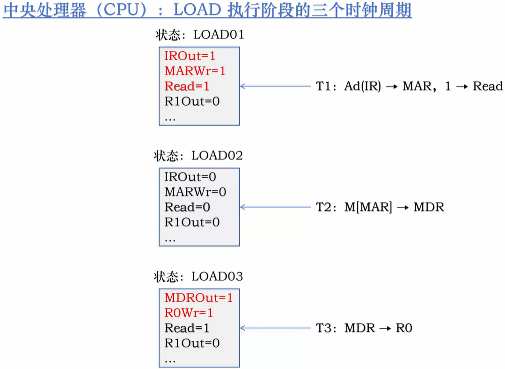 

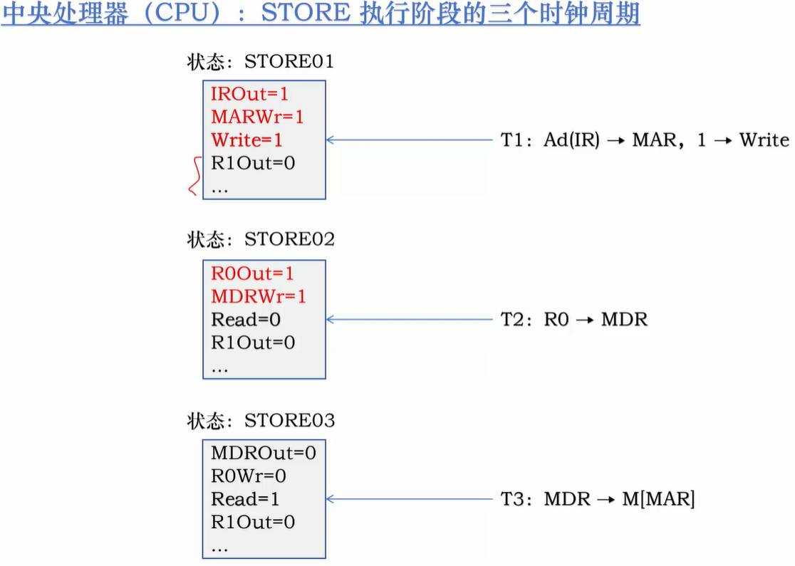 

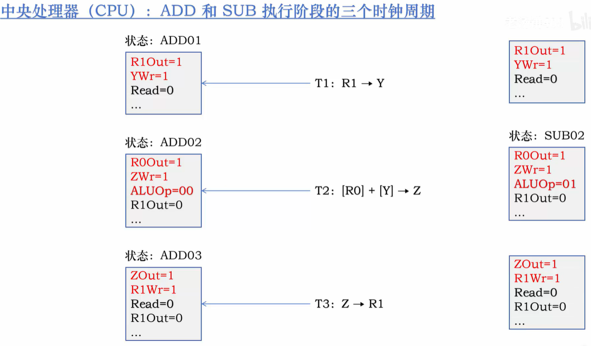 

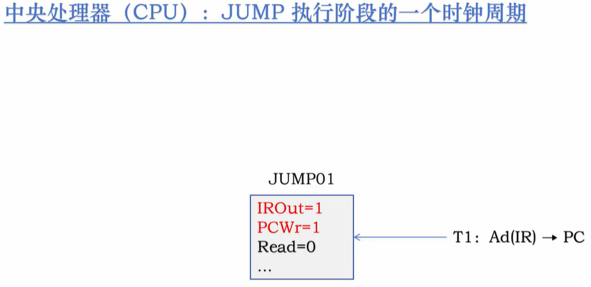 

指令周期:取出并执行指令所花费的时钟周期数

## 4.控制单元的设计实现

### 1.组合逻辑控制单元

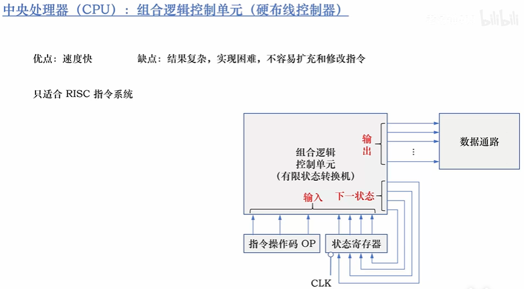 

### 2.微程序控制单元

微程序是一个微指令序列，一条微指令包含若干个微命令，一条机器指令的功能由一个微程序完成          

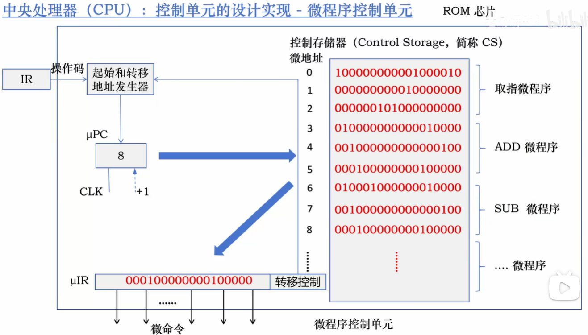     

#### 微程序控制单元的转移控制 ：   
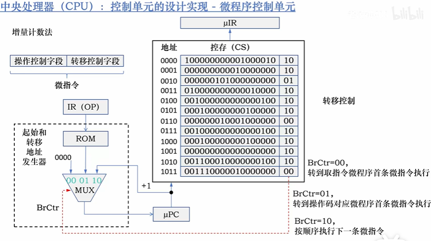     

程序的微指令连续时，使用
1. 增量计数法：

程序的微指令不连续时，使用
2. 断定法：   
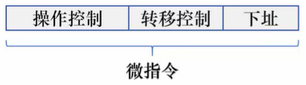     

### 3.微命令编码问题
字段直接编码法： 
其基本思想就是，将微指令分成若干字段，每个字段包含若干微命令，把互斥微命令组合在同一个字段，相容微命令组合在不同的字段，对每一个字段内的微命令进行编码。  
缩短了微指令的长度，节省了控存空间。

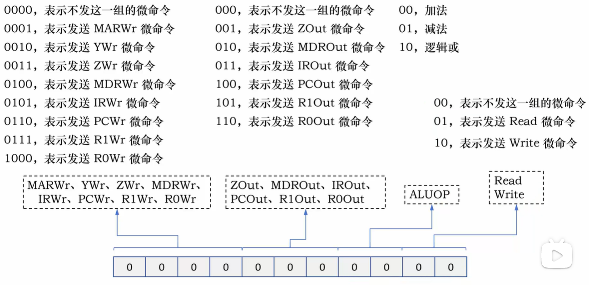     

## 5.CPU的设计

第一步：分析每条指令的功能   
第二步：根据指令的功能给出所需的元件，并考虑如何将它们互连  
第三步：确定每个元件所需控制信号的取值  
第四步：汇总所有指令涉及的控制信号，生成反应指令与控制信号之间的关系表  
第五步：根据关系表，得到每个控制信号的逻辑表达式，据此设计控制电路  

### 1.设计ALU
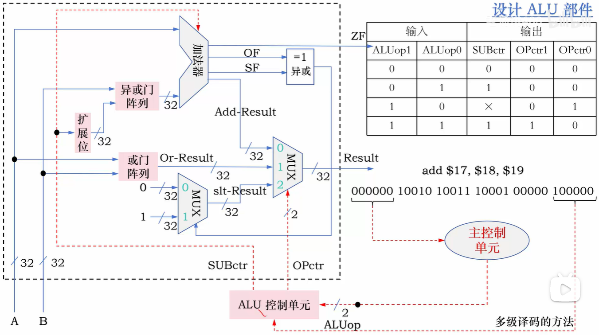    

| 输入 | | | | | | | | 输出 | | |
| --- | --- | --- | --- | --- | --- | --- | --- | --- | --- | --- |
| ALUop1 | ALUop0 | func5 | func4 | func3 | func2 | func1 | func0 | ALUctr2 | ALUctr1 | ALUctr0 |
| 0 | 0 | × | × | × | × | × | × | 0 | 0 | 0 |
| 0 | 0 | × | × | × | × | × | × | 0 | 0 | 0 |
| 0 | 1 | × | × | × | × | × | × | 1 | 0 | 0 |
| 1 | 0 | 1 | 0 | 0 | 0 | 0 | 0 | 0 | 0 | 0 |
| 1 | 0 | 1 | 0 | 0 | 0 | 1 | 0 | 1 | 0 | 0 |
| 1 | 0 | 1 | 0 | 0 | 1 | 0 | 1 | × | 0 | 1 |
| 1 | 0 | 1 | 0 | 1 | 0 | 1 | 0 | 1 | 1 | 0 |

### 2.算术逻辑指令的数据通路

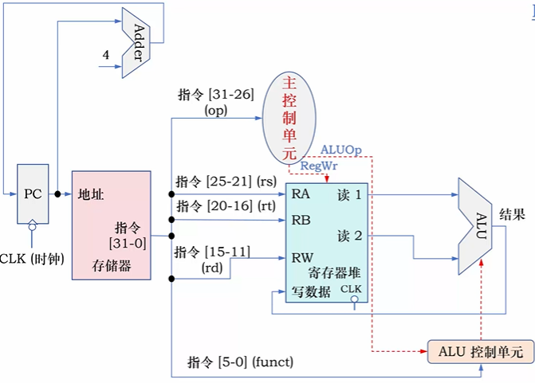    

> *   `add rd, rs, rt`
> *   `sub rd, rs, rt`
> *   `or rd, rs, rt`
> *   `slt rd, rs, rt`

### 3.数据传送指令的数据通路

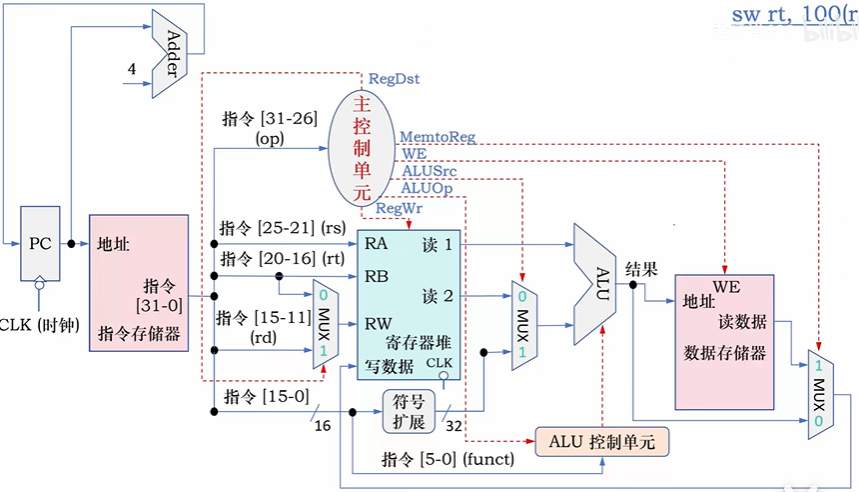    

> *   `lw rt, imm16(rs)`
> *   `sw rt, imm16(rs)`
 
### 4.分支指令的数据通路

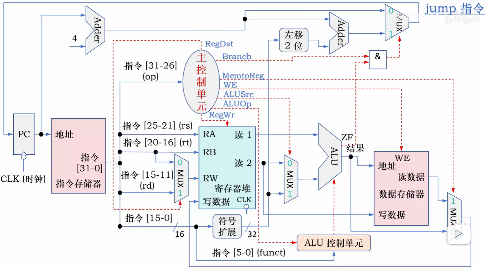    

### 5.单周期控制器

| 控制信号 | R 型指令 | lw 指令 | sw 指令 | beq 指令 | jump 指令 |
| --- | --- | --- | --- | --- | --- |
| RegDst | 1 | 1 | × | × | × |
| Branch | 0 | 0 | 0 | 0 | 0 |
| MemtoReg | 0 | 1 | × | × | × |
| WE | 0 | 0 | 1 | 0 | 0 |
| ALUSrc | 0 | 1 | 1 | 1 | × |
| ALUOp1 | 1 | 0 | 0 | 0 | × |
| ALUOp0 | 0 | 0 | 0 | 1 | × |
| RegWr | 1 | 1 | 0 | 0 | 0 |
| Jump | 0 | 0 | 0 | 0 | 1 |

### 生成指令和控制信号之间的关系表

| 指令 | 输入 (6位操作码) | | | | | | 输出 (控制信号) | | | | | | | | |
| --- | --- | --- | --- | --- | --- | --- | --- | --- | --- | --- | --- | --- | --- | --- | --- |
| | OP5 | OP4 | OP3 | OP2 | OP1 | OP0 | RegDst | Branch | MemtoReg | WE | ALUSrc | ALUOp1 | ALUOp0 | RegWr | Jump |
| R 型 | 0 | 0 | 0 | 0 | 0 | 0 | 1 | 0 | 0 | 0 | 0 | 1 | 0 | 1 | 0 |
| lw | 1 | 0 | 0 | 0 | 1 | 1 | 1 | 0 | 1 | 0 | 1 | 0 | 0 | 1 | 0 |
| sw | 1 | 0 | 1 | 0 | 1 | 1 | × | 0 | × | 1 | 1 | 0 | 0 | 0 | 0 |
| beq | 0 | 0 | 0 | 1 | 0 | 0 | × | 0 | × | 0 | 1 | 0 | 1 | 0 | 0 |
| jump | 0 | 0 | 0 | 0 | 1 | 0 | × | 0 | × | 0 | × | × | × | 0 | 1 |

## 5.多周期CPU
### 1. 取指令、译码和取数  
**取指令** ①  
**译码和取数** ②
    *   **R 型指令**:
        *   ③ ALU 计算
        *   ④ 写回
    *   **lw 指令**:
        *   ③ ALU 计算
        *   ④ 访存
        *   ⑤ 写回
    *   **sw 指令**:
        *   ③ ALU 计算
        *   ④ 访存
    *   **beq 指令**:
        *   ③ ALU 计算

### 2.数据通路

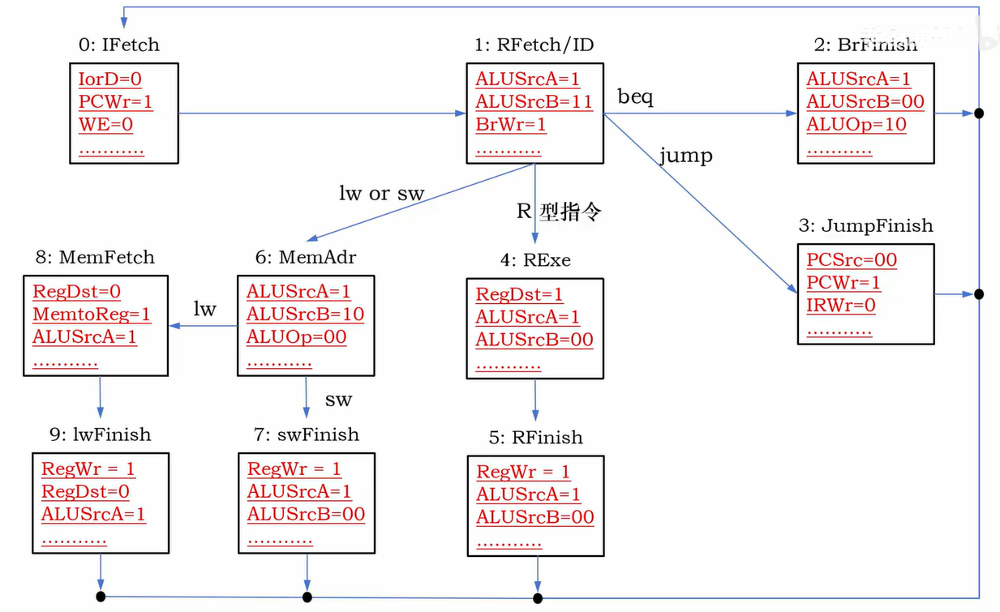    

## 7.流水线

### 1.吞吐量和延迟

对于k 级流水线  
**指令执行时间**: $T_{\text{流水线}} = k \times \text{时钟周期} + (n - 1) \times \text{时钟周期} = (n + k - 1) \times \text{时钟周期}$    
指令吞吐量 $\approx \frac{1}{\text{时钟周期}}$

### 2.数据通路

——

### 3.控制信号的传递

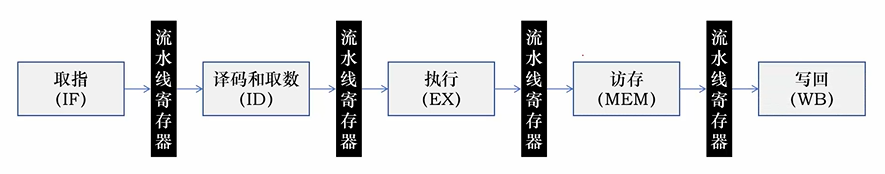    

### 4.流水线冒险——结构冒险

同一周期内，不同指令使用同一个硬件，且此硬件不支持共享，可能会产生冒险

### 5.流水线冒险——数据冒险

- 解决：
1.数据转发技术   
2.插入气泡

### 6.数据线冒险——控制冒险
- 解决：  
动态预测利用分支指令发生转移的**历史情况**来进行预测

