## 本章内容：

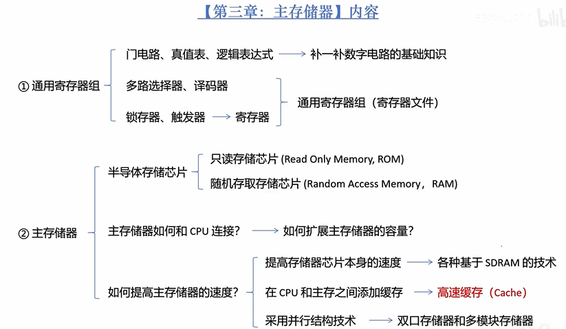

## 1.数字电路的基础知识   

### 1.逻辑门电路
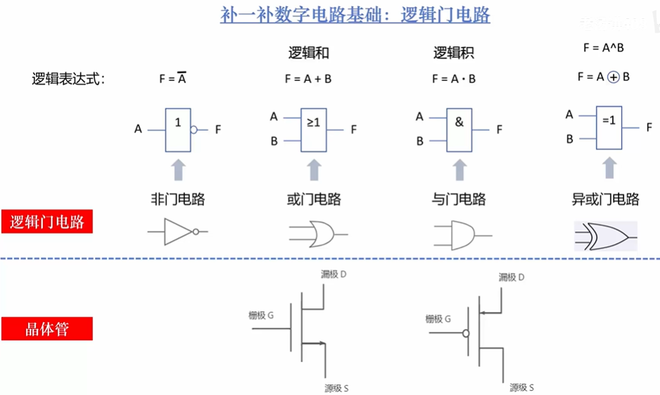

### 2.真值表

真值表中该输出为 1 的表项对应一个乘积项  
乘积项为所有输入的乘积或输入取反后的乘积，是否取反取决于真值表中该变量对应的信号是 1 还是 0

> 根据真值表写：输出逻辑表达式

 ## 2.译码器、多路选择器和锁存器、触发器

### 1.译码器    
将输入转化成对应的十进制，然后将对应的输出设置为 1，其他的输出设置为 0

### 2.多路选择器

多路选择器（multiplexer）：简称 MUX。从多路输入数据中选择其中一路送至输出端。

### 2.锁存器和触发器 

在数字电路中，可以存储一个二进制位的器件称为存储单元电路，包括存器和触发器。

$锁存器$：（举例）

- 逻辑与非门电路  
 
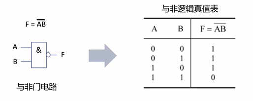

- 逻辑或非门电路

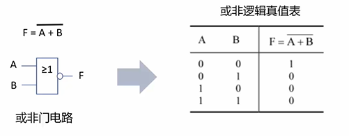
 

#### 1.RS锁存器  
#### 2.门控D锁存器
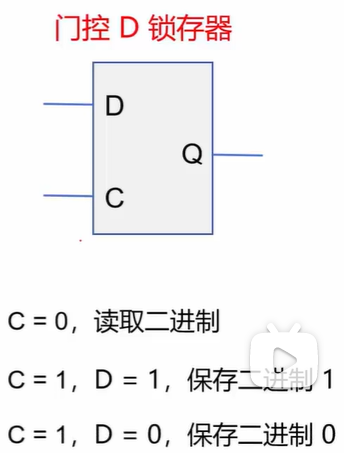

## 3.寄存器和通用寄存器的组成原理

#### 寄存器
寄存器由边沿D触发器组成。 

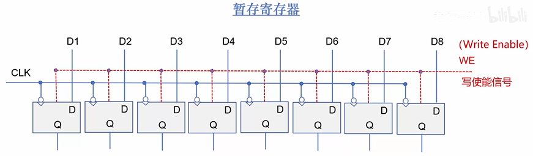

#### 通用寄存器组

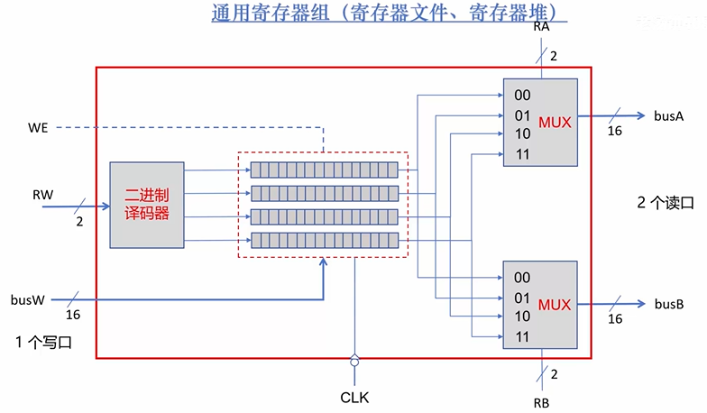

#### 机器字长

机器字长是指 CPU 一次能处理数据的位数，通常与 CPU 的寄存器位数有关

### 半导体存储器的分类：
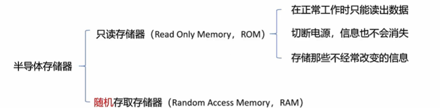

## 4.只读存储器ROM
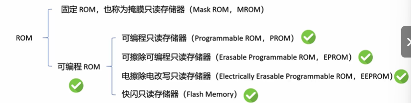

#### 1.固定ROM/掩膜只读存储器 MROM  

由地址译码器和存储阵列两部分组成

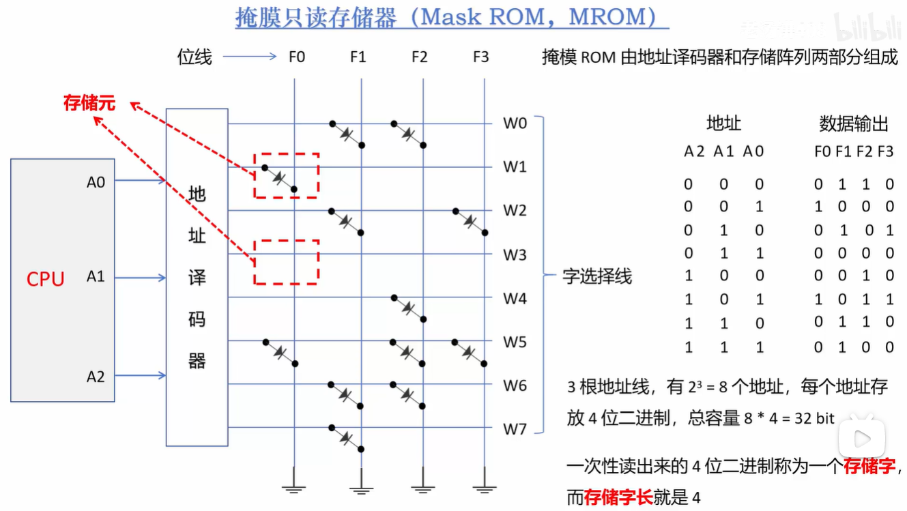

存储信息只读，不能修改。存储内容固定，可靠性高。

#### 2.可编程只读存储器 PROM  

## 5.存储器的二维编码结构
一个芯片：

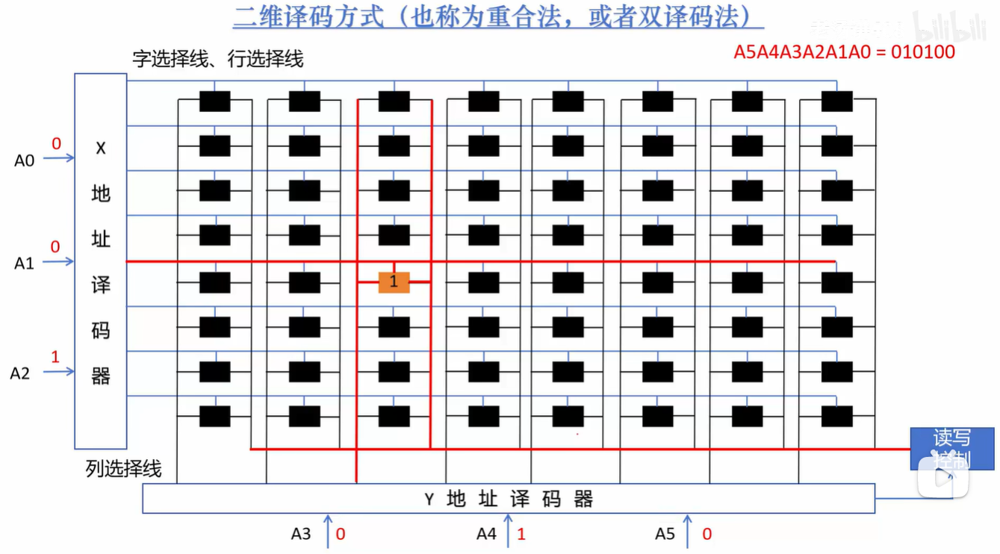

多个芯片：

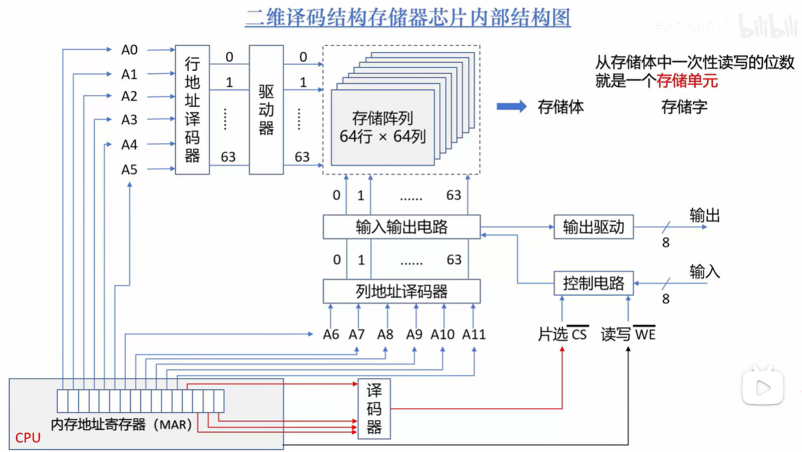

## 6.静态随机存取存储器 SRAM
 
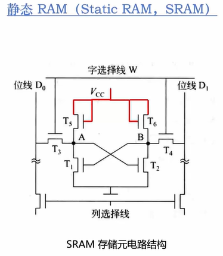

 
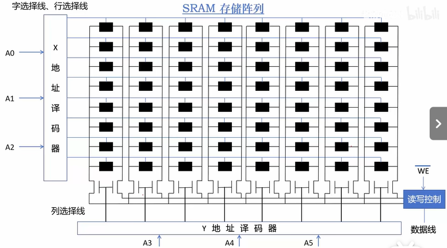

## 7.动态随机存取存储器 DRAM

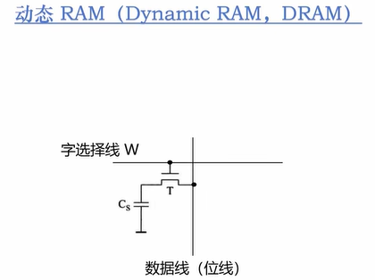

  

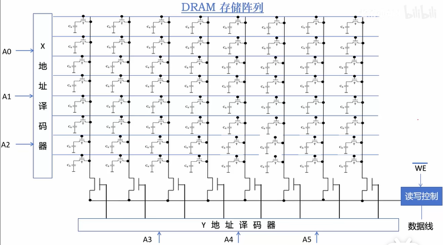

### 存储器的存储周期

**读出时间 $T_A$**：指从存储器接收到读命令开始，至信息被送到数据线上所需的时间

**写入时间 $T_W$**：指从存储器接收到写命令开始，至信息被写入存储器所需的时间

**存储周期 $T_M$**：指存储器进行一次读写操作所需要的全部时间，也就是存储器进行连续读写操作所允许的最短时间间隔

它应该等于读出/写入时间加上一次存取开始前后所要求的附加时间

## 8.DRAM的刷新

电容 $C_S$ 上存储的电荷会缓慢的放电，超过一定的时间，就会丢失信息，这个是电容的特点，因此必须定时给电容 $C_S$ 充电，这一个过程称为**刷新**

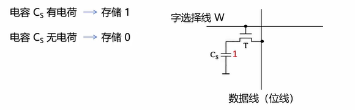

  
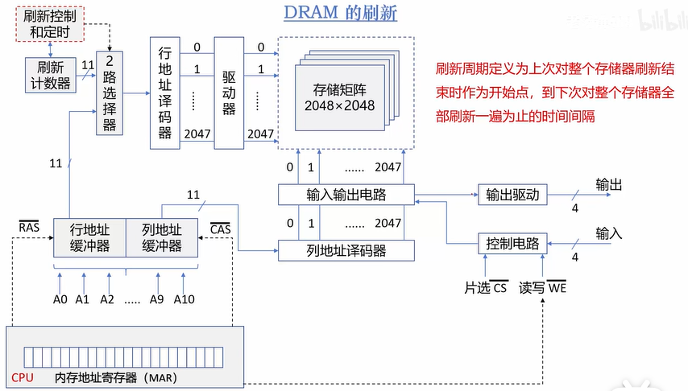

### 刷新的策略

1. 集中刷新  
**集中刷新**是在规定的一个刷新周期内，对全部存储元集中一段时间逐行进行刷新
2. 分散刷新  
**分散刷新**是指对每行存储单元的刷新分散到每个存储周期内完成
3. 异步刷新  
**异步刷新**是前两种方式的结合，它既可以缩短死时间，又充分利用最大刷新间隔为 2ms 的特点

### SRAM vs DRAM

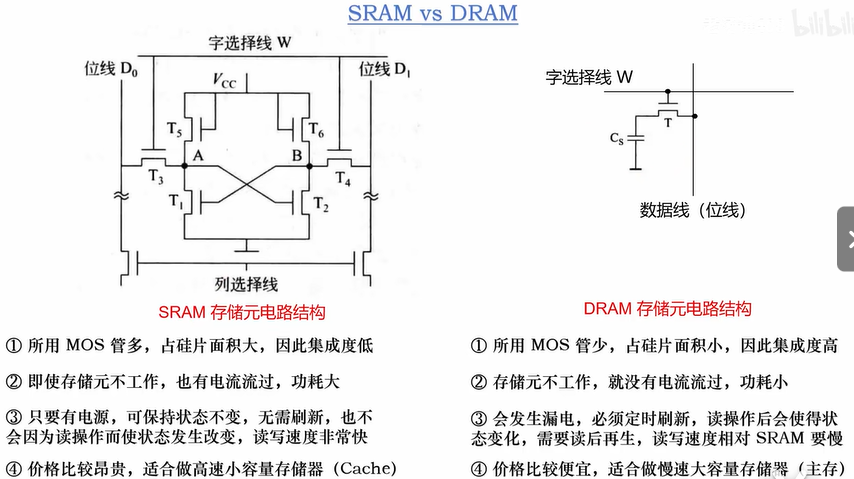

## 9.主存储器和CPU连接

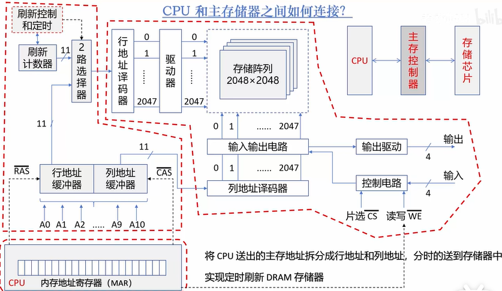

  

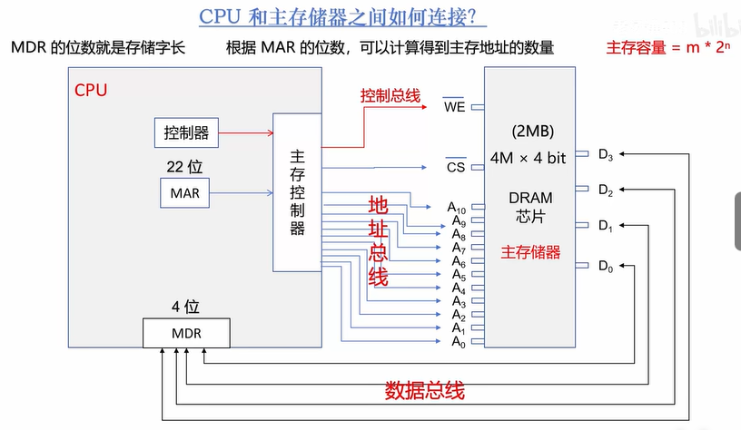   

DRAM采用地址引脚复用技术

## 10.主存储器扩容

 
**存储器容量 = 存储字数量 * 存储字长**

1. **位扩展** → 增大存储字
2. **字扩展** → 增加存储字数量  
3. **位、字扩展** → 同时增大存储字和增加存储字数量

## 11.同步主存储器 SDRAM

#### 早期计算机通信方式
CPU 与主存之间采用 **异步** 方式进行通信。

### 1. 行缓冲器

- 地址分阶段输入：  
先送行地址 → 激活对应行 → 数据加载到行缓冲器
再送列地址 → 从行缓冲器中读取/写入指定列数据
- 时钟同步控制：  
所有命令（如读、写、刷新）都在时钟上升沿触发
CPU 和内存控制器可预测操作完成时间，提升总线利用率
- 流水线操作支持：  
可在前一个操作未完成时启动下一个操作（如预取下一行）
显著提升吞吐量 

### 2.突发传输
定义：
在激活一行后，一次性连续读取该行的多个列数据，而不是逐列访问。

行缓冲器中有：BL（突发长度）,CL（CAS潜伏期）

### DDR SDRAM
基于SDRAM改进，
在时钟信号的上升沿和下降沿各传输一次数据  
相比普通SDRAM（只在上升沿传输），带宽翻倍  
是现代计算机内存的主流技术  

## 12.按字寻址按字节寻址

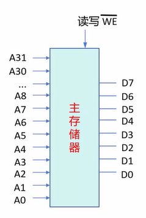   

| 特性 | 按字节寻址 | 按字寻址 |
|------|-----------|---------|
| 最小访问单元 | 1 字节 | 1 字（例如 4 字节或 8 字节） |
| 地址编号 | 每个字节一个编号 | 每个字一个编号 |
| 地址跨度 | 相邻地址相差 1 字节 | 相邻地址相差 1 字（即 N 字节） |
| 常见性 | 几乎所有现代通用计算机 | 早期计算机或某些专用 DSP（数字信号处理器） |

## 13.高速缓存（Cache）

### 1.为什么需要：
局部性原理
### 2.基本工作原理
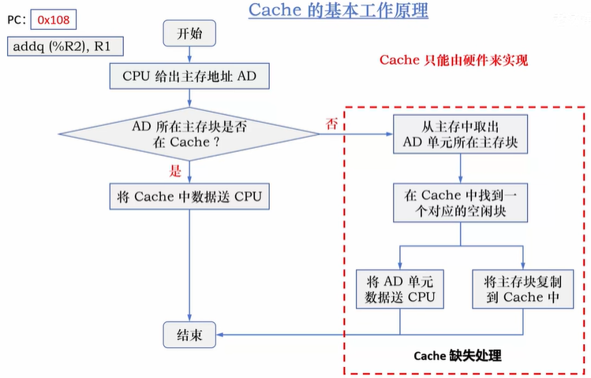   

如果 CPU 访问主存单元所在的主存块在 Cache 中，则称为 Cache 命中 (hit)  
命中的概率称为命中率 (hit rate) ，它等于命中次数与访问总次数之比  
如果 CPU 访问主存单元所在的主存块**不**在 Cache 中，则称为 Cache 不命中 (miss)  
不命中的概率称为缺失率 (miss rate)，它等于不命中次数与访问总次数之比

### 3.Cashe行和主存钱块之间的映射方式

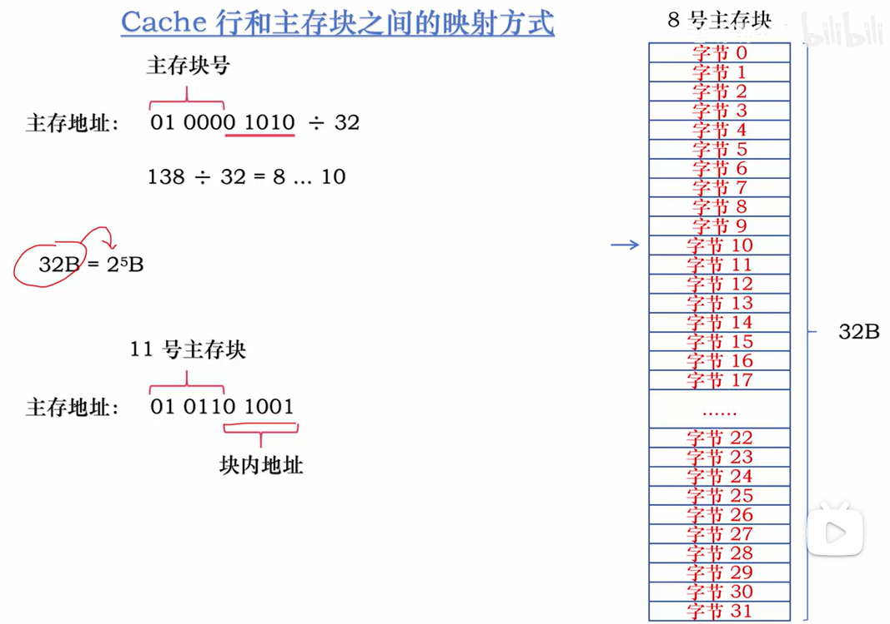

除以32，相当于主存地址左移5位，分为主存储号和块内地址，取余。

1. 直接映射  
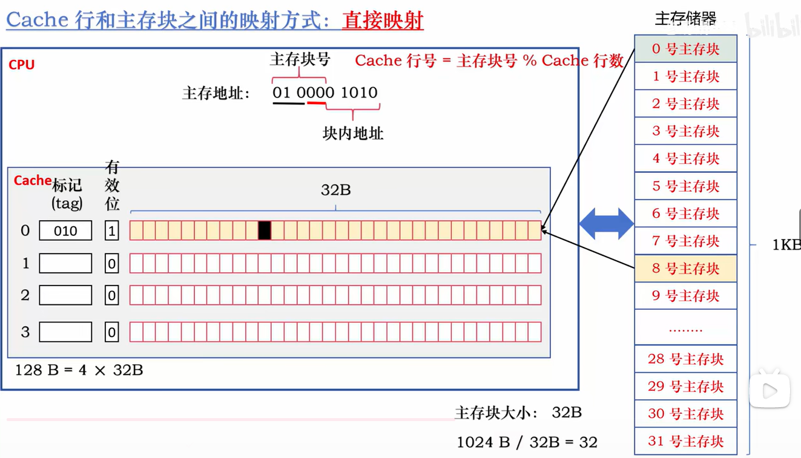

2. 全相连映射  
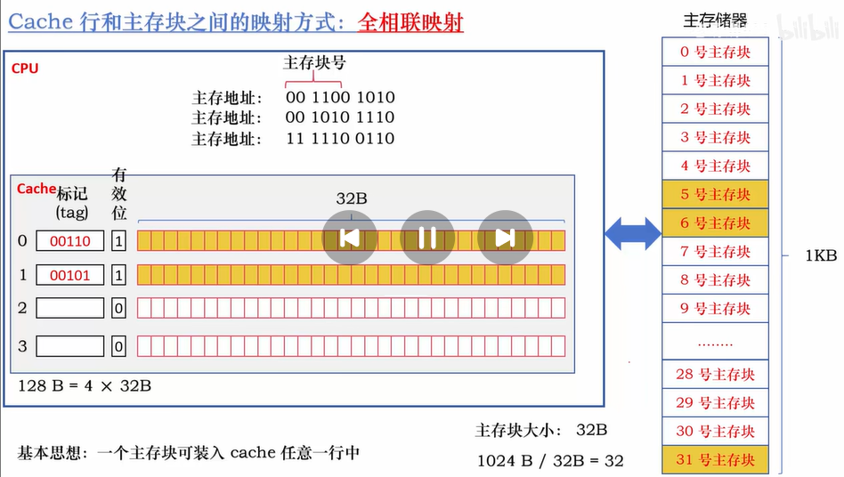

3. 组相连映射  
**基本思想是**：将 Cache 所有的行分成 $2^v$ 个 **大小相等** 的组，每组有多个 Cache 行，每个主存块被映射到 Cache 固定的组中的任意一行
也就是说 主存块与 Cache 组采用直接映射 ，而在 Cache 组内，主存块和 Cache 行采用 全相联映射的方式
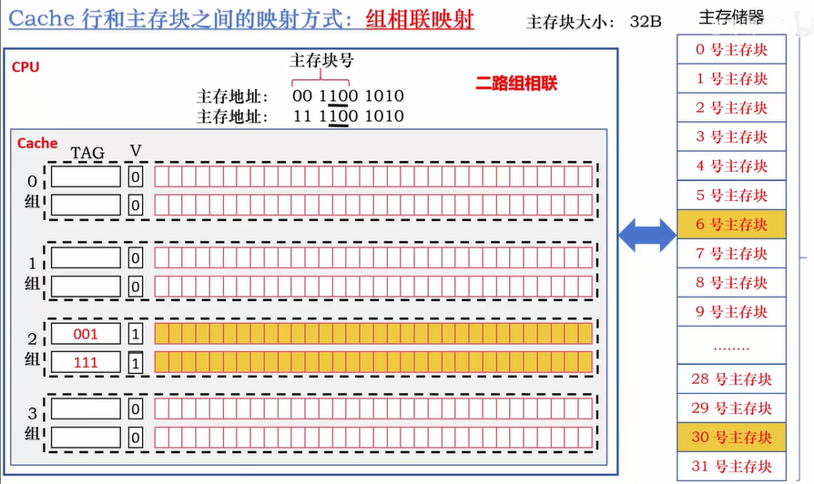

- **直接映射**：1 个比较器

- **全相联映射**：有多少 Cache 行，就有多少比较器

- **组相联映射**：每组多少个 Cache 行，就有多少个比较器  
 
**关联度**指一个主存块映射到 Cache 中时可能存放的位置个数
- **直接映射**：1
- **全相联映射**：Cache 总行数
- **N路相联映射**：N  
 
当 Cache 大小、主存块大小一定时，关联度和命中率、命中时间、标记所占额外开销等有如下关系：
1. **关联度越低，命中率越低**。因此直接映射命中率最低，全相联映射命中率最高。
2. **关联度越低，判断是否命中的开销越小，命中时间越短**。因此，直接映射的命中时间最短，全相联映射的命中时间最长。
3. **关联度越低，标记所占额外空间开销越少**。因此，直接映射额外空间开销最少，全相联映射额外空间开销最大。

### 4.Cache组成块替换算法

1. 先进先出  
**FIFO 算法的基本思想是**：总是选择**最早装入 Cache 的主存块被替换**

2. 最近最少用  
 **LRU 算法的基本思想是**：总是选择**近期最少使用的主存块被替换**。当前最少使用的块一般来说也是将来最少被访问的。
**软件实现**：哈希表 + 双向链表

3. 最不经常用（LFU）   
替换Cache中被访问次数最少的块

4. 随机替换算法
从候选行的主存块中随机选择一个进行替换。

### 5.Cache的一致性问题  
1. 全写法  
写操作时，若写命中 Cache，则同时写 Cache 和主存（Cache和主存储器中都有）
否则写不命中：
- 写分配法：先写入主存储器，再写入Cache。
- 非写分配法:只写入主存储器。

2. 回写法  
若写命中，则信息只被写入 Cache 而不被写入主存。等到Cache被替换时，才写入主存储器。

## 14.并行结构技术：双口存储器和多模块存储器        

1. 双口存储器     
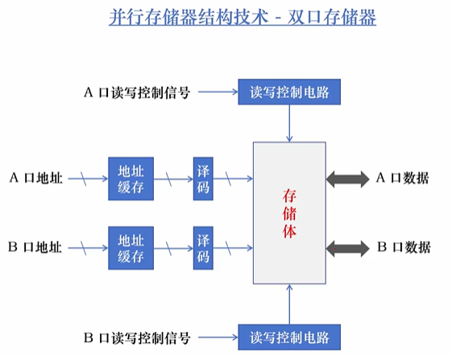

2. 多模块存储器       
各自具有独立的地址寄存器 MAR、数据寄存器 MDR、地址译码器、驱动电路和读写电路

- 连续编址方式    
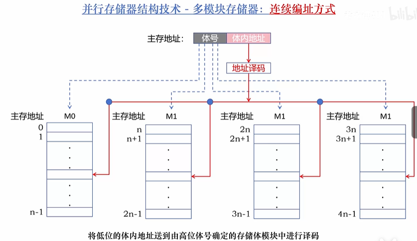       
不可以并行读取
- 交叉编址方式         
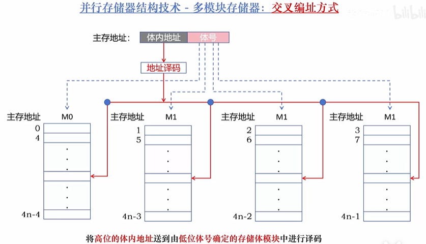  
可以并行读取，
$T_M$ :存储周期，
- 轮流启动，8根数据线，每1/4周期传8位数据。
- 同时启动，32根数据线

#### 内存条
每个内存条可以由多个存储芯片得到。

