## 1.MIPS中的寄存器寻址
通用寄存器：

| 名称 | 编号 | 功能 |
| --- | --- | --- |
| zero | 0 | 恒为 0 |
| at | 1 | 为汇编程序保留 |
| v0 ~ v1 | 2 ~ 3 | 过程调用返回值 |
| a0 ~ a3 | 4 ~ 7 | 过程调用参数 |
| t0 ~ t7 | 8 ~ 15 | 临时变量，在被调用过程无需保存 |
| s0 ~ s7 | 16 ~ 23 | 在被调用过程需保存 |
| t8 ~ t9 | 24 ~ 25 | 临时变量，在被调用过程无需保存 |
| k0 ~ k1 | 26 ~ 27 | 为 OS 保留 |
| gp | 28 | 全局指针 |
| sp | 29 | 栈指针 |
| fp | 30 | 帧指针 |
| ra | 31 | 过程调用返回地址 |

## 2.MIPS中的基址寻址

基址寻址：通过基址寄存器 + 偏移量。适合数组访问     
数据传送指令：在主存储器和寄存器之间传送数据指令

**sw: store word**, 用于将指定寄存器中的一个字 (32 位) 数据传送到指定内存地址的内存单元中

*   `sw $2, 24($sp)`
    *   寄存器 `$2` → 内存地址 `($sp) + 24`
    *   **偏移量 (offset)**: `24`


**lw: load word**, 用于将指定内存地址的一个字 (32 位) 数据传送到指定寄存器中

*   `lw $2, 12($sp)`
    *   寄存器 `$2` ← 内存地址 `($sp) + 12`

**内存寻址范围**: $0 \sim 2^{32} - 1$ 字节，也就是 4GB

>   `$sp` 也可以称为**基址寄存器 (base register)**

3种寻址方式

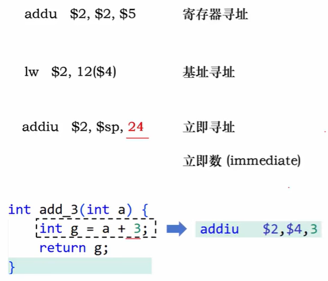

## 3.MIPS中的R型指令
遵循简单源于规整的原则，所有 MIPS 指令都是 32 位二进制

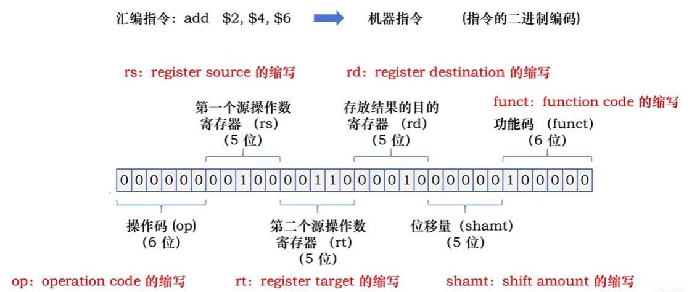

操作码结构：000000。具体操作类型有功能码决定。

## 4.MIPS中的逻辑运算指令（R型指令格式）

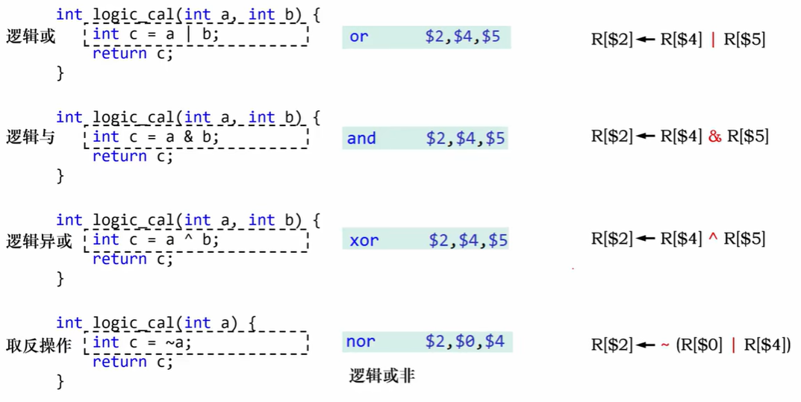

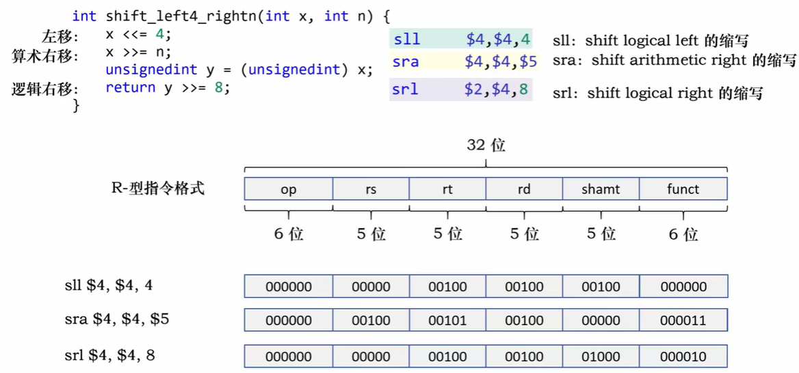

## 5.MIPS中的乘法和除法指令

两个 32 位的乘商寄存器：Hi 和 Lo 专用寄存器

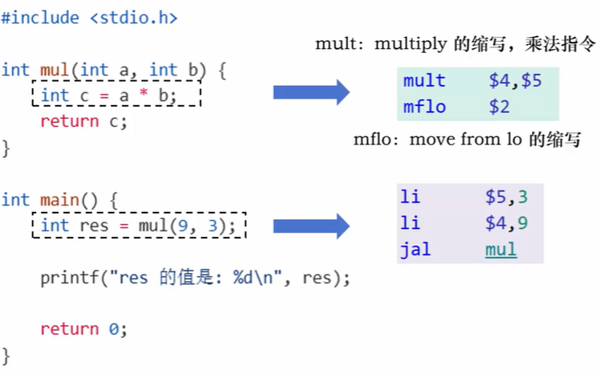

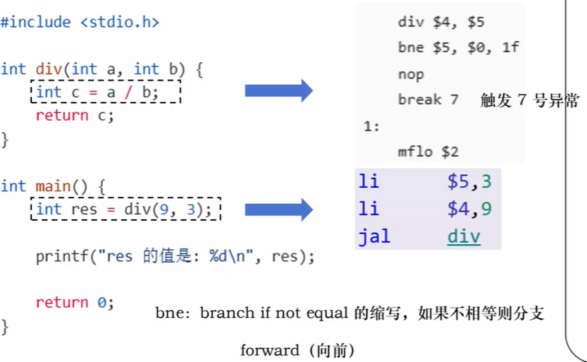

## 6.MIPS中的I型指令

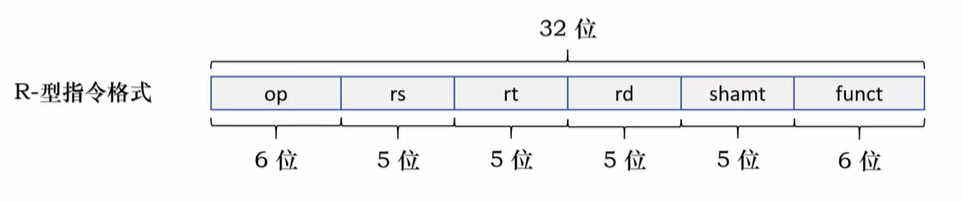

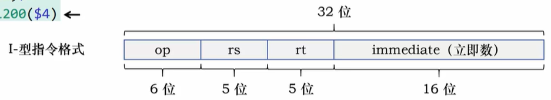

## 6.MIPS中实现if语句

| 指令 | 说明 |
| :--- | :--- |
| `beq $rs, $rt, label` | beq: branch if equal 的缩写，如果相等则分支（跳转） |
| `bne $rs, $rt, label` | bne: branch if not equal 的缩写，如果不相等则分支（跳转） |


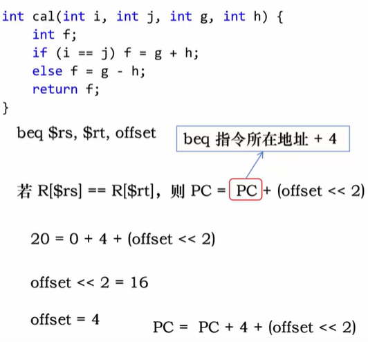

> 注意：beq 和 bne 跳转指令的参数为 label，而不是跳转地址。
> 注意PC的变化,偏移量的取得应该是计算机内部计算了的，需要学习如何计算偏移量


*   **b**: branch 的缩写，无条件分支指令
*   **slt**: set on less than 的缩写，小于则置位
*   **sll**：shift left logical 的缩写，左移 

```
slt $4, $2, $4    # if (R[$2] < R[$4]) R[$4]=1 else R[$4]=0
```
### 跳转和相对寻址

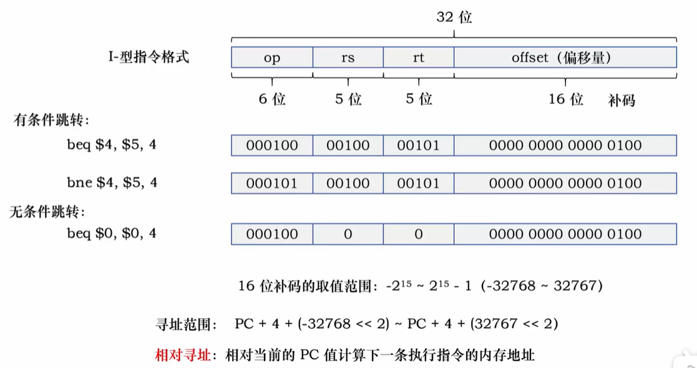


## 7.MIPS中实现while语句

汇编语言实现while语句：  
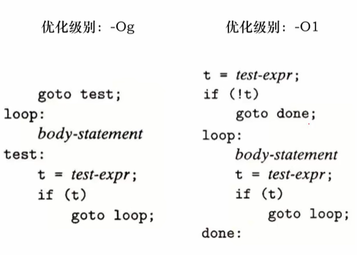

## 8.MIPS中实现for语句
 
翻译成了while语句

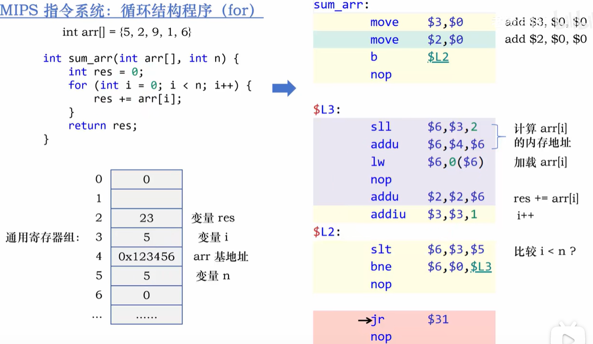


## 9.MIPS中实现调用

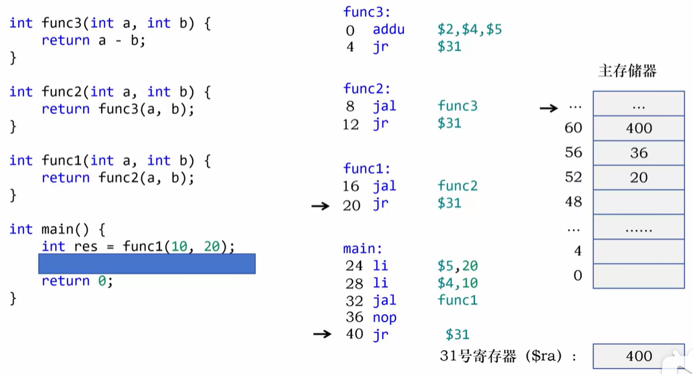

### 机器级表示

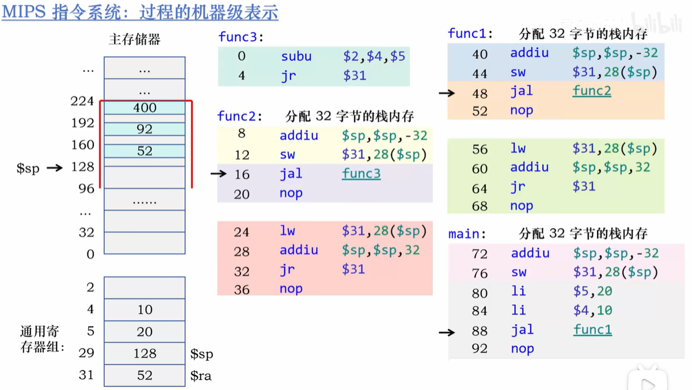


### 栈帧

栈帧，也叫活动记录（Activation Record），是程序在调用函数时，在运行时栈（Stack）上为当前正在执行的函数开辟的一段连续、固定大小的内存区域。每个函数调用对应唯一一个栈帧，函数执行结束栈帧就被释放。  

栈帧的核心作用：
保存返回地址存放 $ra$，保证函数执行完能正确回到调用处，防止嵌套调用覆盖返回地址。  
保护寄存器现场保存需要保留的寄存器（如 $s 寄存器$），避免被其他函数破坏。  
存储局部变量寄存器数量有限，函数内部局部变量存放在栈帧中。  
传递溢出参数超过寄存器数量的参数（MIPS 中前 4 个用 $a0-$a3）通过栈帧传递。   
支持嵌套调用与递归每次调用都新建栈帧，多层调用互不干扰，递归才能正常工作。  
维护函数调用层次栈帧按调用顺序入栈、出栈，形成清晰的调用链，便于调试与异常处理。   

## 10.MIPS中的J型指令

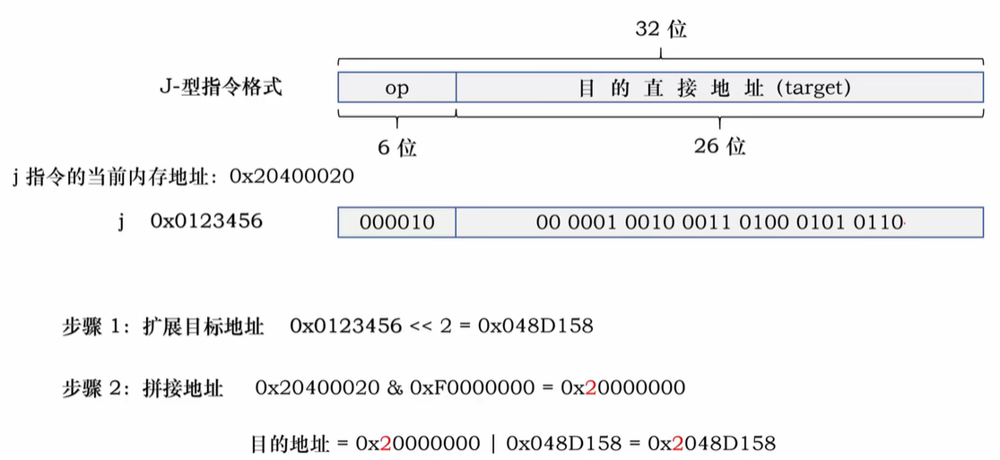

jal: jump and link 的缩写，跳转和链接指令（过程调用）

> 总结寻址方式：
> 1. 寄存器寻址
> 2. 立即数寻址
> 3. 基址寻址
> 4. PC 相对寻址
> 5. 伪直接寻址


## 11.MIPS中的printf的机器级表示

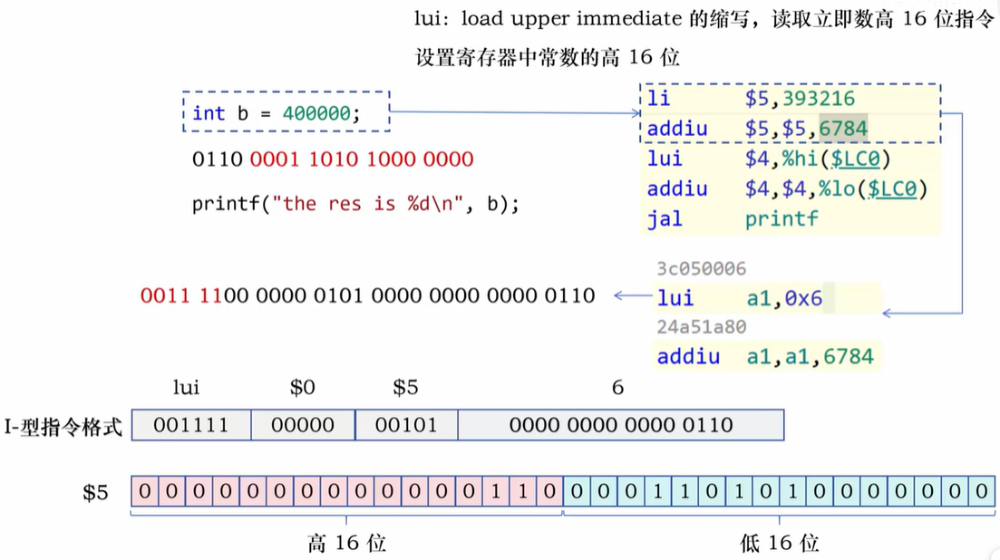

当  `li  $5,400000`   偏移量大于16位时，需分为两次加载。加载到寄存器时，需要将高16位和低16位分别加载到 $t0 和 $t1 寄存器中，再进行或运算。


## 12.MIPS中C指针的机器级表示

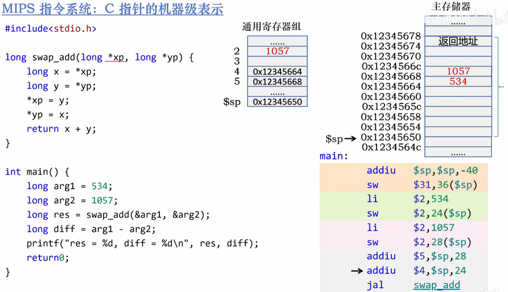


## 13.X86-64指令系统的寄存器


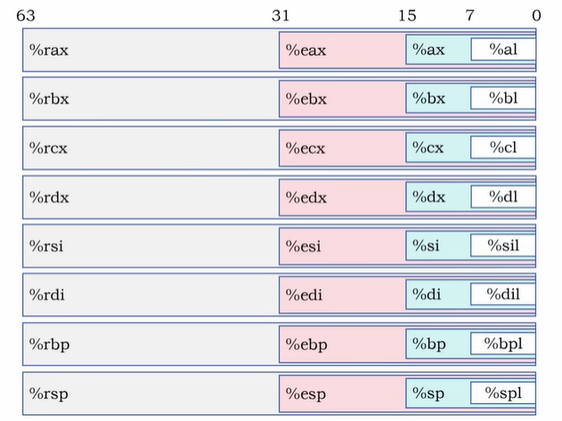

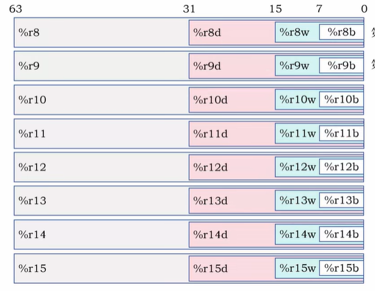


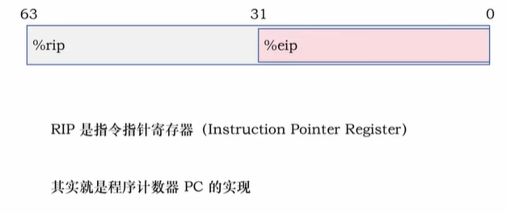


### 数据大小

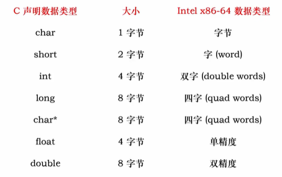


## 14.X86-64指令系统器数据传输指令

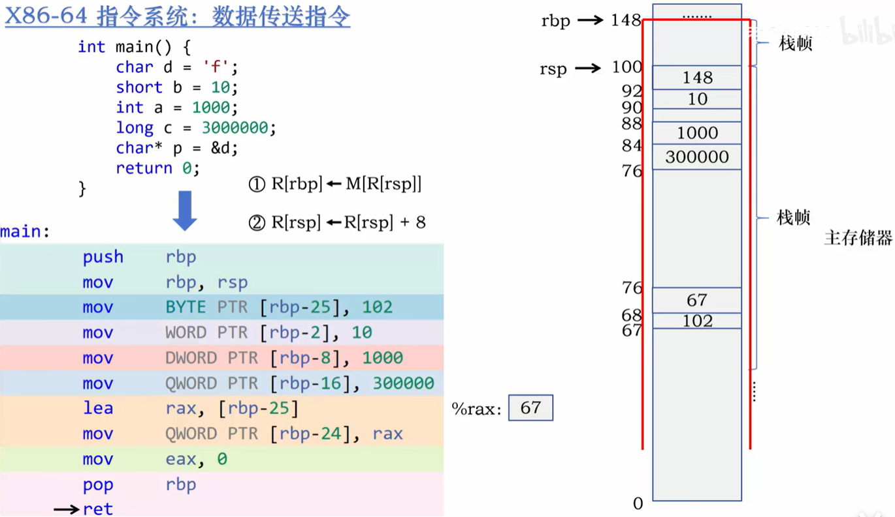


