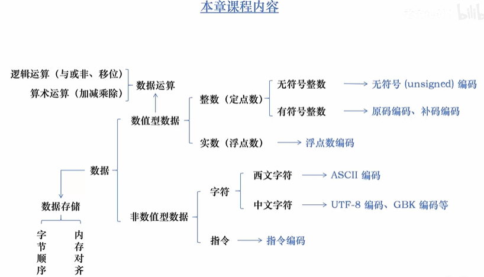
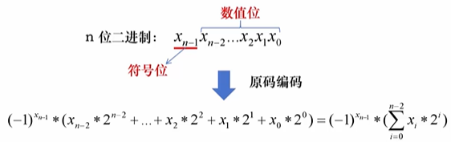
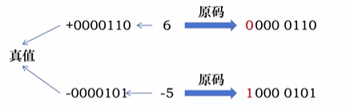
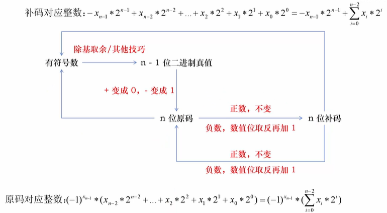
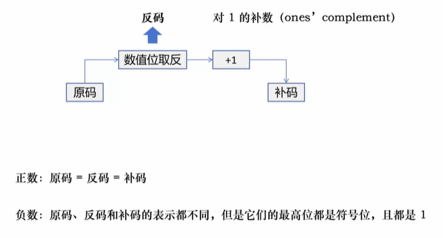
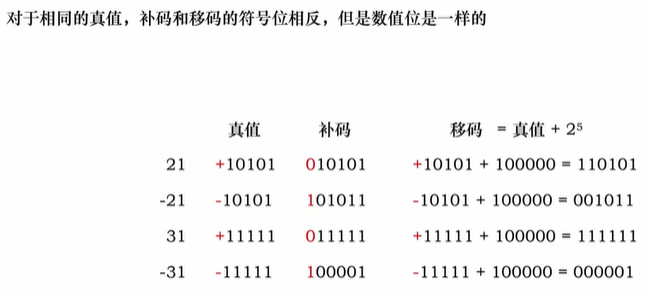

## 本章流程：

## 1.非数值数据的编码
1. 西文字符-ASCII

2. Unicode字符集
它为世界上几乎所有的字符都规定了一个唯一的数字编号，这个编号我们称为码点 (Code Point)。   
没有规定码点在计算机中如何存储。 

3. UTF-8
UTF-8 最大的一个特点，就是它是一种变长的编码方式  
它使用 1~4 个字节表示一个符号，根据不同的符号而变化字节长度

4. GBK编码
GBK 采用双字节编码方案。对于简体中文汉字，通常使用两个字节来表示一个汉字。   
对于 ASCII 字符（英文字符、数字、常见符号等），GBK 采用单字节编码，其编码范围与 ASCII 编码相同，即 0x00 到 0x7F

## 2.无符号整数的编码

## 3.有符号整数的编码
1. 原码编码  

原码（0不唯一）

## 4.原码、真值、补码之间的转换

### 移码
$[x]_{移} = 2^{n-1} + x \quad\quad x 是真值，n 是 x 原码的位数，也是移码的位数$

