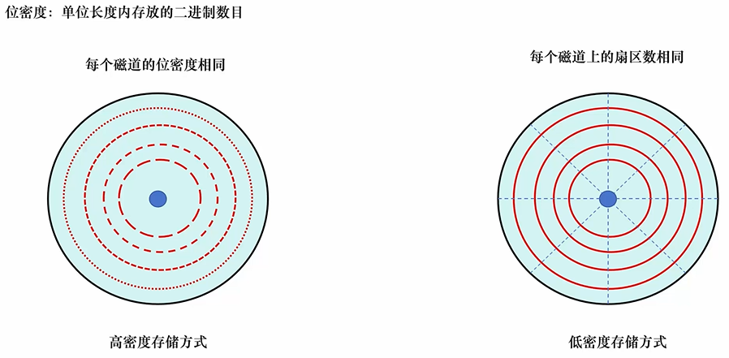
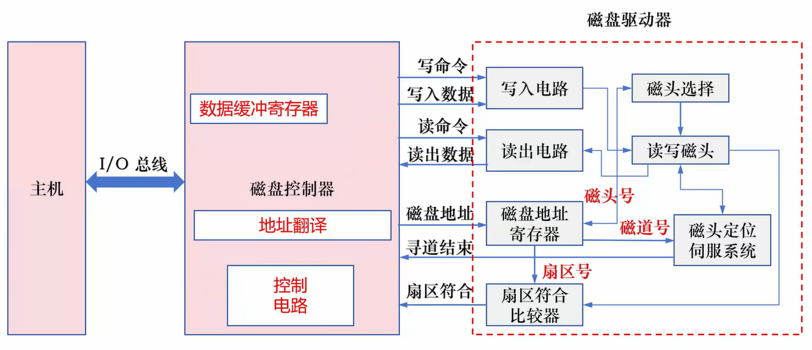
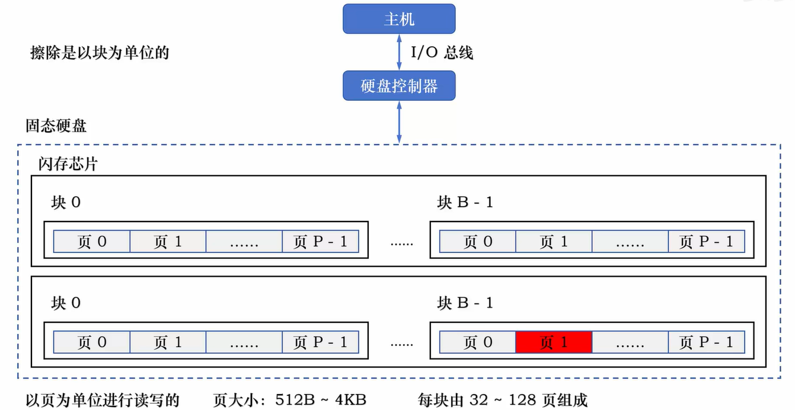
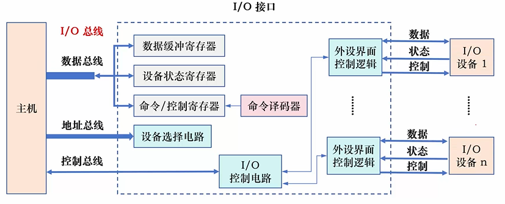
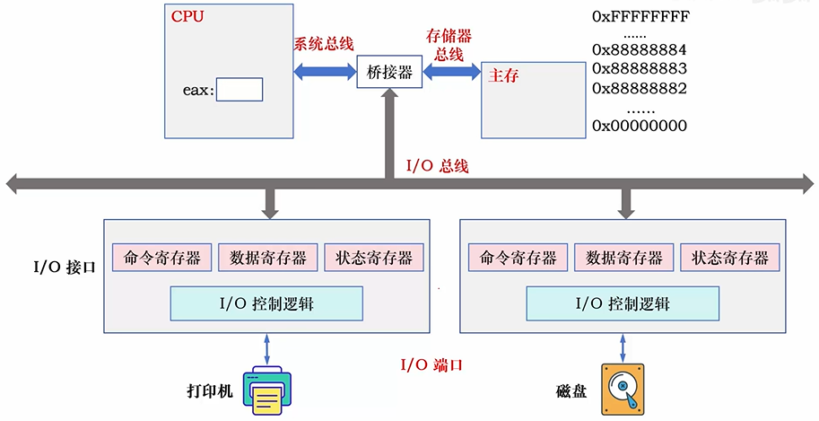
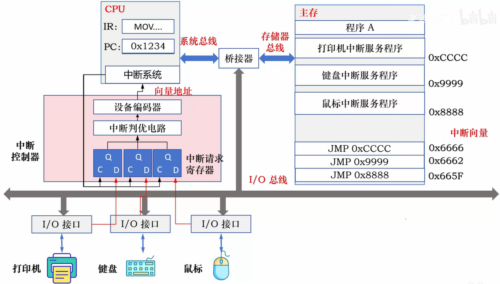
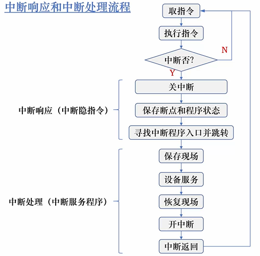
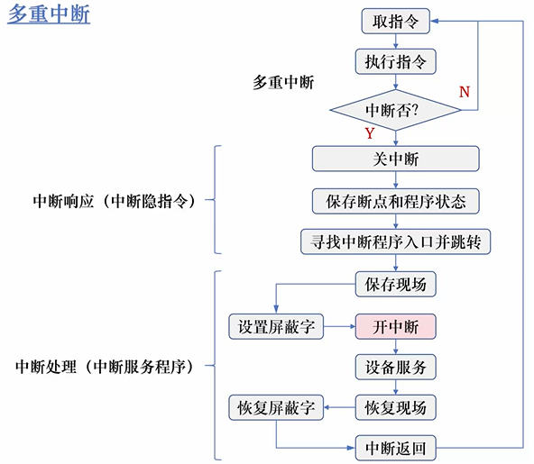

## 1.硬盘

一个盘面由若干个称为磁道的同心圆组成 每个磁道被划分成若干个扇区。

    

## 1.机械硬盘
### 1.存储方式
#### 1.低密度存储方式

*   **未格式化**:  
    磁头数 × 磁道数 × 扇区数 × 一个扇区大小（包括头空、ID 域、间隙、数据域、尾空）

*   **格式化**:  
    磁头数 × 磁道数 × 扇区数 × 一个扇区大小（数据位 512 字节）

#### 2.高密度存储方式

*   **格式化**:  
    磁头数 × 磁道数 × 平均扇区数 × 一个扇区大小（数据位 512 字节）

### 2.平均存取时间

T = 寻道时间 + 旋转等待时间 + 数据传输时间

平均旋转等待时间等于旋转一周需要的时间的一半

平均寻址时间 = 平均寻道时间 + 平均旋转等待时间

平均存取时间 = 平均寻道时间 + 平均旋转等待时间 + 数据传输时间

### 3.磁盘驱动器和磁盘控制器

    

## 2.固态硬盘（SSD）
#### 1.闪存芯片
- 读取数据的速度非常快，和半导体 RAM 相当  
- 写数据的速度和磁盘差不多 。  先擦除，再写数据  
- 闪存的读操作和写操作速度相差很大  

- 缺点：闪存擦除的次数是有限的

#### 2.固态硬盘
    

**动态磨损均衡**：写入数据时，自动选择较新的闪存块，老的闪存块先歇一歇

**静态磨损均衡**：就算没有数据写入，SSD 也会检测并自动进行数据分配，
让老的闪存块承担无须写数据的存储任务，同时让新的闪存块腾出空间，
平常的写操作在较新的闪存块中进行

## 2.I/O接口

    

I/O 端口:
独立编址方式和统一编址方式

## 3.I/O方式
### 1.程序查询方式

- 程序独占查询控制
- 程序定时查询控制

### 2.中断控制方式
   

#### 1.中断响应的条件和步骤

CPU 响应中断的条件：
- **条件一**：至少要有一个中断请求  
- **条件二**：当前指令刚执行完  
- **条件三**：CPU 处于开中断状态

中断处理流程： 

   

#### 2.多重中断控制方式

是指当 CPU 正在执行某个中断服务程序时，
另一个中断源又提出了新的中断请求，而 CPU 又响应了这个请求，
暂时停止正在的中断服务程序，转去执行新的中断服务程序。

   

### 3.DMA控制方式

专门使用 DMA 接口来控制外设与主存之间的直接数据交换，数据不通过 CPU

